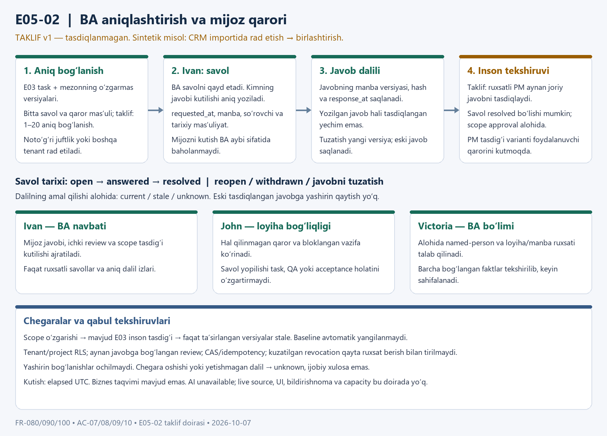

# E05-02 BA clarification — proposed scope v1

2026-10-07. **Image and depicted E05-02 scope approved; not implemented.** User approved the diagram and “BA qayd etadi → PM tasdiqlaydi” workflow with “Ha maqullayman.” E05-01 was committed as `21b7339c277f531eff73808548a1bd1b937ca6c1` on `role-evidence-monitoring`; new task branch `ba-clarification-tracking` starts at that commit. No push/merge/deployment authorized.

Approved image v1: 1600×1150 PNG, SHA256 `2bd3cc426b93dccdadd0190507d2381b2188c65d096169b18eda64eb90d92592`. Root visually inspected the rendered image; all text fits its cards. Its historical proposal/pending labels are superseded by this dated user approval; approved image bytes remain unchanged.

This records the approved image/scope for the next independently reviewable synthetic backend slice. It is not the written implementation specification or plan. Image approval is complete; written-spec review and plan/execution approval still precede product code. The approval permits writing the new architectural design.

## Intended result and source trace

Ivan records an unresolved business question and a customer answer with provenance. John sees its permitted task dependency and pending review/scope decision. Victoria sees a separately authorized BA department queue. Customer waiting is an explicit dependency, never evidence of employee inactivity or fault.

Authoritative repository specification v1.0: §9 FR-080 (paragraphs203–209), §10 FR-090 (214–215), §11 FR-100 (223–226), E05-BE/DATA/QA (608–612), AC-07/08/09/10 (662–665). Hash verified unchanged: `e13b83e55872a3497bcce4f08f2ac3cf32e0c02da484678079d9b30fd69901bf`. Business-calendar aging is a specification requirement deferred from this synthetic slice, not implemented by elapsed UTC. This module does not complete full six-role AC-07 or all E05.

## Approaches considered

| Approach | Tradeoff |
| --- | --- |
| Dedicated BA clarification module, reuse proven QA patterns — recommended | Keeps QA contracts stable; explicit BA decision lifecycle, permissions and version history. |
| Extend QA handoffs to include BA answers | Less initial scaffolding but conflates test handoffs with customer decision review and changes accepted QA contracts. |
| Implement BA, broad PM escalation, calendars and capacity together | More complete role scope, but too large for one independently reviewable unit and requires additional decisions/designs. |

## Approved depicted workflow and design details

- One question, one accountable decision party and one resolution; up to20 exact `(task_version, criterion_version, blocks|context)` links, each validated against the actual E03 association. This is a proposed synthetic bound, not a measured production target. Independently resolved decisions use separate questions.
- States: `open → answered → resolved`; immutable correction, explicit reopen and withdrawal. Current applicability is independently `current/stale/unknown`. No older resolved-answer fallback when the newest input is unavailable or invalid.
- Approved human workflow: BA records the externally attributed answer; an explicitly authorized PM confirms the exact current response/request boundary. This is a user-approved slice decision, not a specification-mandated John approval. Recording and PM confirmation do not prove actual customer authenticity.
- A recorded synthetic customer party/locator is distinct from the internal employee recorder, decision owner and reviewer. Missing or ambiguous identity remains unknown; no email/name merging or external signature verification claim.
- Resolving the clarification never writes task completion, QA acceptance, approved progress or baseline. A proposed scope change remains `scope_approval_pending` until the existing E03 authenticated approval path changes versions. Relinking new task/criterion versions is explicit and invalidates prior resolution.
- Whole-record visibility is conservative: all named and linked facts must be permitted before text, page limits or counts are exposed. Department named-person permission is separate. Hidden links are not counted or partially disclosed.
- Source/version/hash/time, original recorder/reviewer proofs, event-time responsibility and immutable history remain separate from current viewer permissions. Revocation applies before delivery and replay; observed terminal invalidity cannot silently revive after grant restoration.
- `requested_at`, `response_at`, `occurred_at`, `source_updated_at` and server `received_at` remain distinct UTC facts. Expose elapsed UTC only; `business_age=null/calendar_unavailable`. Missing/future/inconsistent timestamps yield unknown.

## Acceptance candidates — not executed tests

1. CRM duplicate-import question blocks exact tasks/criteria; John sees pending customer decision separately from Andrew's existing QA blocker; Victoria sees only permitted BA facts.
2. Answer recorded stays awaiting review; review targets its exact immutable version/hash. Correction or reopen prevents old review from resolving the new episode.
3. Reject-to-merge scope proposal never updates E03 directly. Existing E03 approval selectively stales affected inputs and preserves unaffected evidence, history and denominators.
4. Cross-tenant/project, mismatched task/criterion, duplicate links, stale CAS and conflicting replay reject atomically. Valid identical replay adds no new facts.
5. Reassigned tasks preserve historical responsibility. Missing identity/current proof/linked version produces unknown, never favorable readiness or blame.
6. Revoked current/source/original authority denies or withholds delivery; restored grants do not revive observed invalid evidence. Healthy unrelated questions remain usable.
7. Hidden multi-links and actor/graph/page overflow disclose no hidden identifiers/counts; coverage stays unknown where completeness cannot be established.
8. Elapsed time is not business time or employee hours. No score, finance, external AI, live source writes or automatic notifications.

## Gates and constraints

All product AI remains local-only and unavailable. Existing E04 OS parser remains disabled. No production frontend choice, inference provisioning, live source integration, notification/calendar/capacity, general escalation lifecycle, retention policy activation or deployment is included. DEC-02/03/05 real-data gates remain open; five-person privacy threshold remains an unapproved proposal.

`grill-me` is absent from the session catalog; focused requirements questions and this proposal replace its discovery workflow. No UI is being designed, so the unavailable `ui-ux-pro-max` capability is not used. Separate read-only domain and security specialists analyzed the proposal; root integrates their recommendations. They wrote only ignored analysis notes and performed no product changes or database operations.

Approval2026-10-07: the user confirmed the displayed diagram and BA-record/PM-confirm option. The depicted dedicated BA module, bounded exact links, conservative whole-root visibility, immutable history, separate E03 scope approval, elapsed UTC and unavailable AI define this approved scope. Further technical details belong in the written design for user review; approval does not authorize an unseen plan or implementation.

[Written design v1](../superpowers/specs/2026-10-07-e05-ba-clarification-design.md) is prepared for user review. Root checked requirement locators, actual role codes, placeholders, state/scope consistency, party registry and independent proof/category bounds. Security specialist identified three design clarifications; root incorporated persistent scope obligations, role-proof checks and separate actor/reference limits. These are design checks, not executed behavioral tests or implementation approval.
