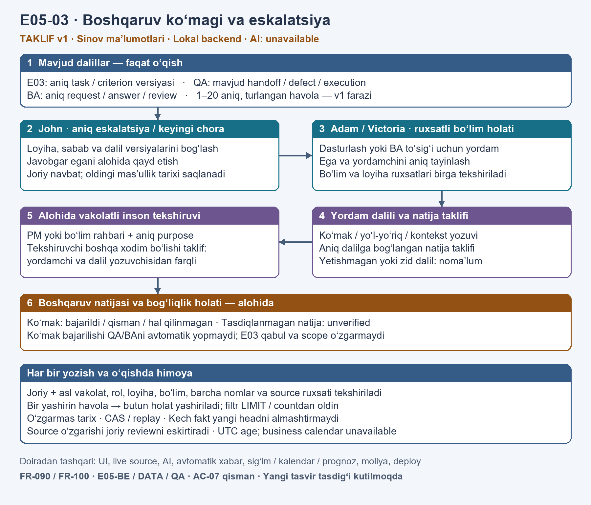

# E05-03 — boshqaruv ko‘magi va eskalatsiya: diagramma taklifi v1

2026-10-09. **Tasdiq holati: APPROVED — foydalanuvchi ko‘rsatilgan v1 tasvir va doiraga “Tasdiqlayman, ishni boshla.” deb javob berdi.** PNG o‘zgarmagan; undagi taklif/tasdiq kutilmoqda yozuvlari tasdiqdan oldingi taqdimot holatini aks ettiradi. Ushbu qayd diagramma/doira tasdig‘idir; yakuniy yozma arxitektura spetsifikatsiyasi yoki implementation plan emas. Product code, migratsiya va yangi modul testlari bajarilmagan.

PNG SHA256: `b24d27d90b482b6dc534c30e4fadd7c8992f77c71e526efcd603f99ffbb77334`. Tasvir 1800×1540, native Pillow diagrammasi; yangi bitmap tahriri yoki ImageGen ishlatilmagan. Arial/Arial Bold Windows fontlari tekshirildi; tasvir `view_image` orqali ko‘rib chiqildi: matn/oqim o‘qiladi, bloklar va strelkalar kesilmagan.

Branch `management-support-tracking`; reviewed E05-02 commit bazasi `2c66c55fa5ec7e7084a08a72a2f45f0ab69bdc81`. E05-01 QA va E05-02 BA approved synthetic backend qismlari tugallangan; tarixiy ochiq ro‘yxatlar ularning hozirgi holatini almashtirmaydi. E04 actual OS parser disabled; lokal model/inference yo‘q. Barcha Codex agentlar uchun foydalanuvchi modeli `gpt-6.1-sol`, reasoning `medium`; boshqa model/effortga o‘tish yo‘q.

## Maqsad va tavsiya etilgan doira

Johnning aniq eskalatsiyasi va Adam/Victorianing aniq ko‘magi, egasi, yordamchi tayinlovi hamda dalilga bog‘langan natijasini tekshiriladigan tarixda saqlash. Bu yangi Laravel/PostgreSQL business-evidence moduli taklifi; Python/inference faollashtirish emas. Sinov ma’lumotlari ishlatiladi, AI interpretation `unavailable`.

| Yondashuv | Afzallik | Cheklov |
| --- | --- | --- |
| **Alohida kichik management-action aggregate — tavsiya** | QA/BA aniq dalillarini o‘qib, boshqaruv ko‘magi va tekshiruvini mustaqil ko‘rsatadi | Yangi typed reference, ruxsat va immutable history dizayni kerak |
| QA handoffni universal boshqaruv recordiga kengaytirish | Dastlab kamroq yangi struktura | Mavjud QA semantikasi BA/customer decisionni to‘liq ifodalamaydi; reviewed QAga ortiqcha o‘zgarish xavfi |
| Hozir E06ga o‘tish yoki E04 activationni tuzatish | Baholash yoki native parserni oldinga suradi | E06 yangi effort/comparison/calendar farazlarini talab qiladi; E04 mustaqil OS security gate. E05 boshqaruv izi ochiq qoladi |

Mavjud `QaHandoffService` va migratsiya22/24 allaqachon `support_requested`, owner, acknowledgement, resolution va context tarixini saqlaydi. Yangi modul ushbu handoffni qayta yaratmaydi yoki uning holatini yozmaydi. BA clarification/answer/review va PM-confirm ham qayta yozilmaydi.

## Tasvirdagi oqim va taklif etilgan rollar

1. E03 aniq task/criterion versiyasi; QA mavjud handoff/defect/execution; BA aniq request/answer/review reference’lari faqat o‘qiladi. Versiya, hash va scope saqlanadi; bir xil UUIDning mavjudligi semantik bog‘lanishni isbotlamaydi.
2. John — current PM role va aniq purpose bilan loyiha eskalatsiyasi/keyingi chorani yaratadi; sabab, exact source facts va javobgar ega alohida qayd etiladi.
3. Adam/Victoria — current department_head role, aniq loyiha va bo‘lim vakolati bilan tegishli programming/BA holatini ko‘radi, yordamchi va egani aniq tayinlaydi. Ega/yordamchi task assignee bilan avtomatik tenglashtirilmaydi.
4. Vakolatli xodim aniq yordam, yo‘l-yo‘riq yoki context faktini va dalilga bog‘langan natija taklifini yozadi. Nomlar/email avtomatik identity merge bermaydi; missing/ambiguous identity yoki dalil unknown qoladi.
5. Alohida vakolatli PM yoki department_head natijani tekshiradi. **Taklif etilgan mustaqillik:** reviewer employee UUIDsi yordamchi va ko‘mak dalili recorder employee UUIDlaridan farqli; bir xodimning ikki user accounti mustaqillik emas. Bu yangi v1 design choice, tasdiqlangan kompaniya production policy emas. Reviewer role title’ning o‘zi yetmaydi; exact purpose/project/source va tegishli department authority kerak.
6. Boshqaruv natijasi `bajarildi`, `qisman` yoki `hal qilinmagan` fakt sifatida alohida ko‘rsatiladi; tasdiqlanmagan natija `unverified`. Yordamning tugashi underlying dependency resolution emas. E03 acceptance/progress/baseline, QA verification/defect/handoff va BA decision/scope obligation avtomatik o‘zgarmaydi. Mijozni kutish BA aybi emas; keyingi yaxshilanishga dalilsiz yakka shaxsga e’tirof berilmaydi.

## Doira invariantlari

- Joriy actor, linked source, barcha nomlangan xodimlar, majburiy asl action/review authority va effective role/membership/grant validity tekshiriladi. Project+department scope talab qilingan joyda ikkala scope ham kerak. Exact replacement grant/role oldingi proofni tuzatmaydi; observed terminal invalidity qayta tiklash bilan favorable bo‘lmaydi. Wholly unobserved same-row revoke/restore tarixini mavjud store qayta qurmaydi.
- Bitta yashirin source/xodim/reference butun holat matni, ID, count va cursorini yashiradi. Visibility LIMIT/countdan oldin qo‘llanadi, har bir pagination deliveryda qayta tekshiriladi; hidden global total berilmaydi.
- Tenant/project composite keys, FORCE RLS, nonowner runtime, append-only fact/review history va CAS/idempotency taklif qilinadi. Yangi modul QA/BA/E03 yozuvlarini o‘zgartirmaydi. Scoped safe audit payloadsiz ID/hash/reason code saqlaydi.
- Original assignment/role mas’ulligi occurred_atdagi effective interval bilan saqlanadi; explicit owner change faqat joriy navbatni o‘zgartiradi. Occurred_at, received_at, source_updated_at ajratiladi; kech/old fact yangi current headni almashtirmaydi. Yetarli ordering/interval isboti yo‘q bo‘lsa unknown.
- Source/task/criterion correction yoki mandatory authority revocation ta’sirlangan current review/outcome applicabilityni stale/unknown qiladi; eski history saqlanadi. Fresh independent review kerak; old favorable fallback yoki outstanding BA scope obligation laundering yo‘q.
- Elapsed UTC navbat yoshi jarayon konteksti; future/negative/inconsistent time unknown. Business age/calendar unavailable. Ishlangan soat, unumdorlik/ranking, sig‘im yoki muddat va’dasi hisoblanmaydi.

## v1 farazlari va keyingi dizayn tanlovlari

Har bir holat uchun **1–20 exact typed reference** taklif qilinadi. Text≤4000 UTF-8 bytes, review reason≤2000; root body≤65536 bytes/depth16; default20/max50 page — mavjud synthetic BA konservativ chegaralarini qayta ishlatish taklifi. Ular production capacity yoki measured performance emas. Actor/proof/reference kategoriyalarining alohida budgeti, canonical hash/replay counters, typed operation-role-purpose matrix va bounded lock/read adapterlari keyingi yozma spetsifikatsiya/rejada aniqlanadi; reference countdan mustaqil authority prooflarni bir actor bilan collapse qilish taqiqlanadi. Overflow unknown/withheld; favorable truncation yo‘q.

Tasvirni tayyorlashni bloklaydigan yangi business savol aniqlanmadi. Tasvir/doira tasdig‘i yangi PM/department reviewer matrix yoki production policy’ni avtomatik tasdiqlamaydi; keyingi yozma dizayn ushbu material engineering tanlovlarni reviewga taqdim etadi. `grill-me` mavjud emas; original specification, approved context va domain/security investigation talablarni aniqlashtirishning alternativasi bo‘ldi; bu skill ishga tushgani da’vo qilinmaydi.

UI, live sources, local inference/model provisioning, avtomatik notification/sending, business calendars/capacity, forecast, finance, deployment va production NFR gate ushbu taklifdan tashqari. To‘liq E05/AC-07 bajarilishi da’vo qilinmaydi.

## Original spetsifikatsiya izlari

Manba `docs/requirements/AI_monitoring_Texnik_spetsifikatsiya_v1_0.docx`, v1.0 2026-10-02. Quyidagi p indekslari `word/document.xml`dagi body-descendant `w:p`, jumladan table paragraphlar, **1-based** tartibida:

| Iz | Paragraph | Ushbu taklif |
| --- | --- | --- |
| FR-090 | p214–215 | John unresolved decisions, follow-up/escalation outcomes; PM productivity proxy yo‘q |
| FR-100 | p223–224 | Muhim cheklov → yordam tayinlash → natijani tekshirish → unresolved record; explicit support va dalilsiz individual credit yo‘q |
| E05-BE | p608 | Eskalatsiya mas’ulligi; QA/BA faktlari va permitted department queue |
| E05-DATA | p610 | Effective assignments/stale evidence current attributionga aralashmaydi; business aging bu slice’da unavailable |
| E05-QA | p612 | CRM escalation va nomlangan olti rolga exact evidence trail; qisman |
| AC-07 | p662 | John/Andrew/Steve/Adam/Ivan/Victoria mas’uliyatlari; QA blocked va BA customer dependency alohida |
| Dependency order | p642 | E04/E05 → E06/E08 → E07; E04/E05 contract stable bo‘lsa parallel |

## Tasdiq qaydi

**Image/scope approved on 2026-10-09.** Foydalanuvchining “Tasdiqlayman, ishni boshla.” javobi aynan ko‘rsatilgan PNG va v1 doiraga tegishli. Yozma architectural design tayyorlanadi; Superpowers architectural workflow bo‘yicha hali taqdim etilmagan yozma spec va rejaning review bosqichlari saqlanadi. Push/merge/deploy ruxsati yo‘q. Model siyosati: barcha Codex agentlar `gpt-6.1-sol`, reasoning `medium`.
