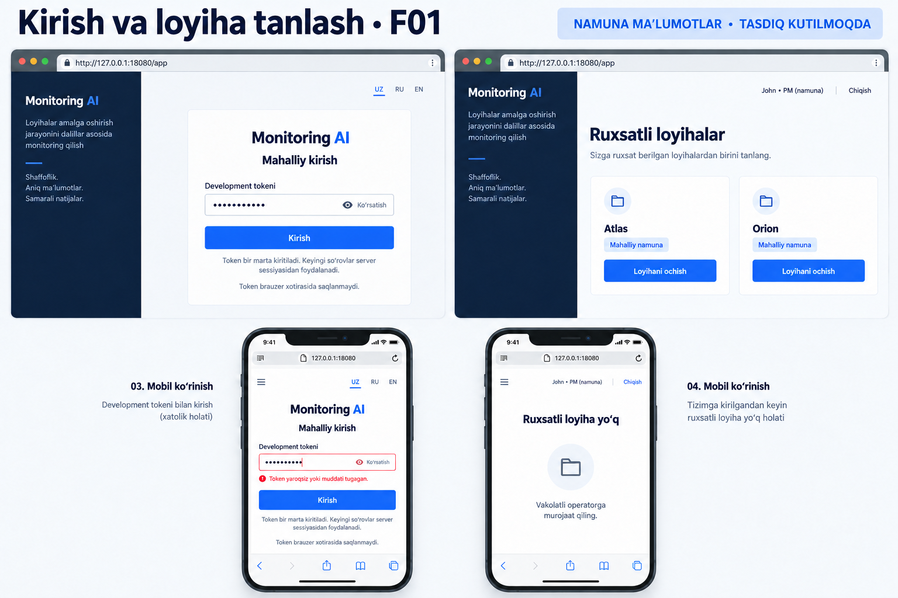
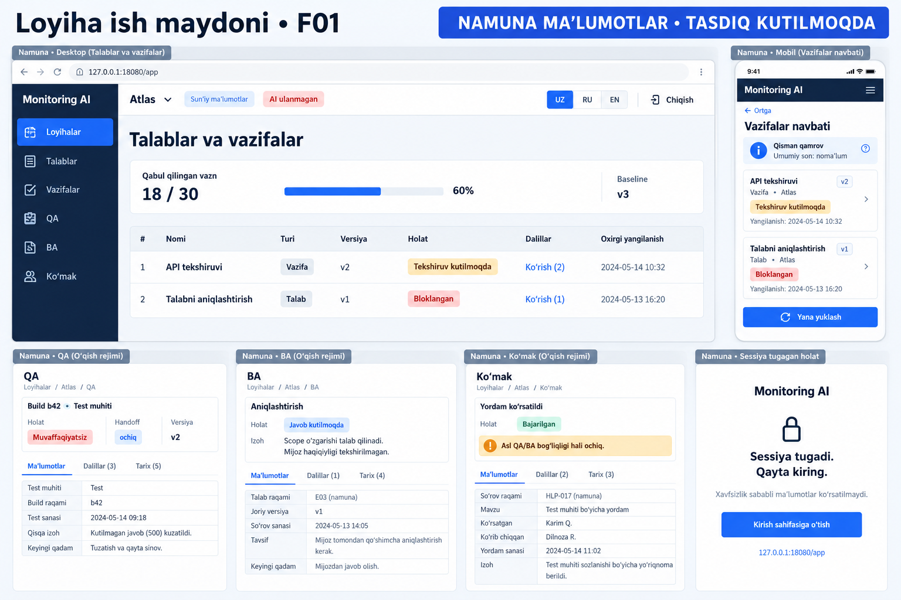
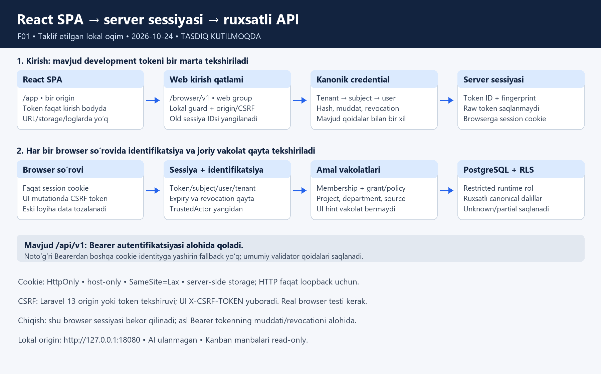

# React frontend F01 — rasmlar to‘plami v1

2026-10-24. **Foydalanuvchi F01 yozma dizayni va quyidagi rasm versiyalarini “Tasdiqlayman” deb tasdiqladi.** React SPA va mavjud tokenni bir marta kiritish → server sessiyasi doirasi saqlanadi. Rasmlardagi “tasdiq kutilmoqda” yozuvi taqdimot vaqtining holati; shu hashlar bilan tasdiqlangan baytlar o‘zgartirilmaydi. Bu ishlayotgan website, xavfsizlik sertifikati yoki haqiqiy ma’lumot isboti emas. [Tasdiqlangan yozma dizayn](../superpowers/specs/2026-10-24-frontend-api-integration-design.md), [UI/UX brief](frontend-api-ui-brief-v1.md). Implementatsiya rejasi keyingi gate.

| Rasm | Scope | SHA256 |
| --- | --- | --- |
| [Kirish/loyiha tanlash](frontend-api-access-v1.png) | Desktop/mobil token input, safe invalid/expired xato, faqat ruxsatli loyiha kartalari va no-project holati | a59b559fe34121bf4a83f4798a96445a33602bfd9b4b9d80295364f34ceb5889 |
| [Ish maydoni](frontend-api-workspace-v1.png) | E03 qabul vazni/baseline, read-only vazifa/dalil, QA/BA/ko‘makning alohida holatlari, mobil partial/null total, sessiya tugashi | d9364feafe3b9fa9f9fc7ceccea6c5f85b2a243d0094db5eedf7e6eed08641c6 |
| [Sessiya/data flow](frontend-api-session-flow-v1.png) | Lokal bir origin, token validation/session binding, har so‘rovdagi joriy vakolat, RLS va alohida Bearer API | 98177f8e0c0f8683b9de212c7df539753032cc09a9b415d6fbad872fcf52084e |

UI rasmlari builtin imagegen bilan yangi raster maket sifatida yaratildi. Kirish rasmi alohida targeted editda tashqi misol domainidan lokal127.0.0.1:18080 manziliga tuzatildi. [Yakuniy promptlar](frontend-api-image-prompts-v1.json) saqlangan. Default generated_images nusxalari qoldirildi; loyiha ishlatadigan tanlangan PNGlar shu katalogga ko‘chirildi. Flow PNG standart Pillow chizish kodi bilan deterministik hujjat diagrammasi sifatida yaratildi; product kod emas.

Rasmlar root tomonidan vizual ko‘rildi: hamma holatlar sig‘gan, haqiqiy token yo‘q, synthetic/approval label bor; QA/BA bog‘liqliklari ko‘mak completed holatidan alohida. 18/30/60%, versiyalar, ismlar va sanalar faqat misol; implementatsiya ularni API faktlari bilan almashtiradi. Dalil/history sonlari faqat ruxsatli obyektning aniq mavjud ma’lumotlari bo‘lsa ko‘rsatiladi; partial/hidden umumiy sonlar rasmdagi misolga qarab to‘ldirilmaydi.

Raster matnlari/chrome elementlari literal shartnoma emas: maketdagi padlock browser bezagi mahalliy HTTPga TLS va’dasi bermaydi; real URL/cookie/security xulqi yozma dizayn bilan belgilanadi. Haqiqiy navigatsiya active holati ochilgan bo‘limga mos bo‘ladi. Accessibility contrast/focus va translated wording running UI/browser reviewda o‘lchanadi; raster buni tekshirganlik isboti emas. Ko‘mak panelidagi reviewer ismi xavfsiz named-privacy doirasida bo‘lsagina chiqadi.

## Qabul qilinadigan doira

F01 autentifikatsiyali o‘qish workspace va UZ/RU/EN system text, desktop/mobil/error/partial holatlari. F02 mutation/approval/selector formalarining tasviri bu rasmlarda yo‘q; to‘liq frontend maqsadi F02 bilan davom etadi va yangi material ekranlar alohida rasm tasdig‘ini oladi. Ulangan AI, jonli source yozuvi, production SSO/report/forecast/finance yoki deploy tasdiqlanmaydi.

